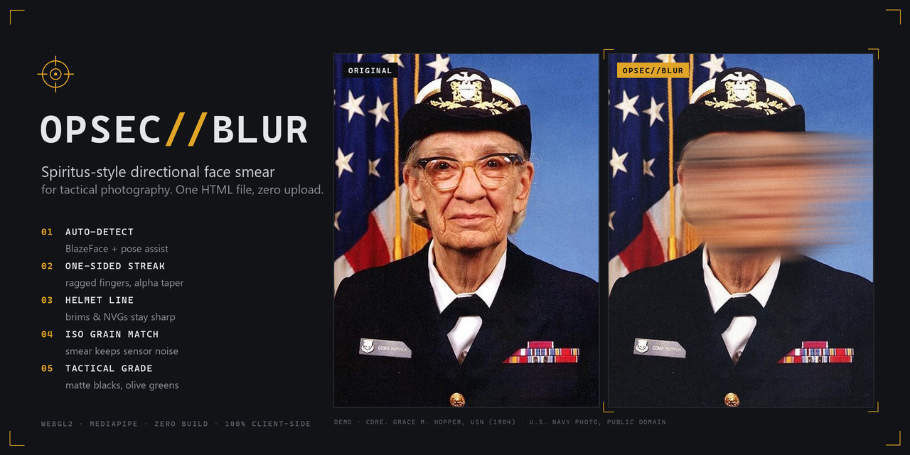
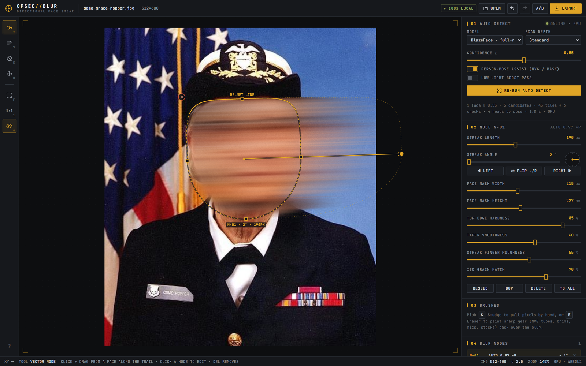
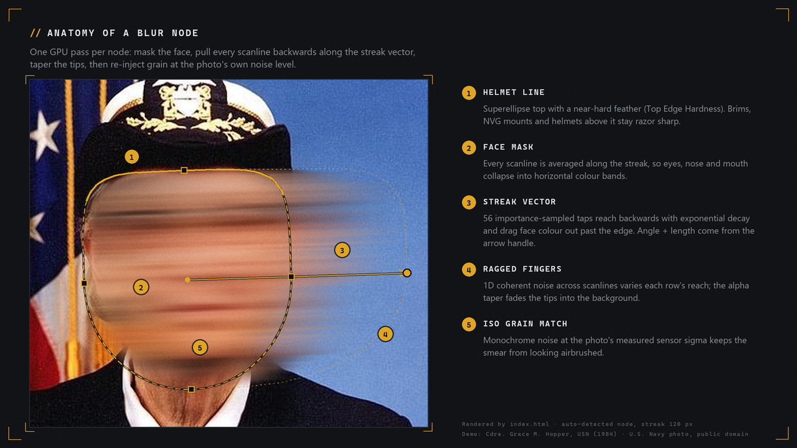

<p align="center">
  
</p>

<h1 align="center">OPSEC//BLUR</h1>

<p align="center">
  <b>Spiritus-style directional face smear for tactical photography.</b><br>
  One self-contained HTML file · WebGL2 · MediaPipe · your photos never leave the machine.
</p>

---

Instead of a Gaussian blob or pixel blocks, each face is dragged sideways into horizontal colour bands that trail off the head in the direction the subject is looking. The trail breaks up into ragged, tapering fingers, the edge under the helmet brim stays razor sharp, and grain is matched to the photo so the smear doesn't look airbrushed.

## Quick start

1. Download [`index.html`](index.html) (or clone the repo).
2. Open it in Chrome, Edge or Firefox. Double-clicking the file works; there is no server or build step.
3. Drop a photo, paste one with <kbd>Ctrl</kbd>+<kbd>V</kbd>, or click **Try the demo photo**. Every detected face gets a blur node.
4. Fine-tune the nodes, then **Export** a full-resolution PNG or JPG.

Add `?demo` to the URL to open straight into the demo photo, which is handy for a GitHub Pages link.

> **Requirements:** a browser with WebGL2. The first load needs internet access for Tailwind, the UI font and the MediaPipe models (jsDelivr, Google Fonts and Google Storage); after that they come from the browser cache. Image data is processed locally and is never uploaded.

## Screenshot



## Features

### Automatic detection
- **MediaPipe BlazeFace (full-range)** runs over a multi-scale tile pyramid, so small and distant faces are found, not just close-ups.
- **Verification pass:** every candidate is re-framed at two crop sizes and re-scored by the short-range model, and its landmark geometry is sanity-checked. Badges, buttons and foliage that look face-like at one scale rarely survive both checks.
- **Person-pose assist (BlazePose)** confirms heads that the face model barely sees behind NVGs, masks or profile angles.
- **Facing direction and head tilt** from the keypoints set each streak's angle.
- **Live confidence slider (0.15–0.95):** nodes appear and disappear as you drag it. Re-running detection never overwrites nodes you placed or edited.

### Manual tools

| Tool | Key | What it does |
|---|---|---|
| **Vector node** | <kbd>V</kbd> | Press on a face and drag along the trail: the press point is the centre, the drag sets angle and length. Click a node to get its gizmo: move it, drag the edge squares to resize (<kbd>Alt</kbd> = symmetric), drag the arrow tip for angle and length (<kbd>Shift</kbd> snaps to 15°), ⊗ deletes. |
| **Smudge brush** | <kbd>S</kbd> | Photoshop-style smudge that drags a brush-sized colour buffer along the stroke. Brush size, strength 70–95 %, streak roughness. |
| **Gear mask eraser** | <kbd>E</kbd> | Paints the original pixels back over the blur to rescue NVG tubes, brims, mics and rifle stocks. Hold <kbd>Alt</kbd> to re-blur. |
| **Pan** | <kbd>H</kbd> | Middle- or right-drag also pans; the wheel zooms at the cursor. |

### Inspector
Streak length, streak angle (with a dial and left/right flip), face-mask width and height, top-edge hardness (the helmet line), taper smoothness, finger roughness and ISO grain match. The sliders edit the selected node, or the defaults for new nodes when nothing is selected.

### Tactical grade
An optional whole-frame look: lifted matte blacks, olive-muted greens, a teal/amber split and coarse 35 mm grain.

### Workflow
Hold <kbd>Space</kbd> to compare with the original, undo/redo everything, and export at full resolution. Exports are re-encoded from the canvas, so EXIF, GPS and camera serials are not carried over.

## How the smear works



Each node is drawn by one WebGL2 fragment shader in the node's local frame, where *u* runs along the streak and *v* across it:

1. **Mask.** A superellipse with a flat, hard top (the helmet line) and a soft elliptical chin. In front of the face, each scanline extends by its own noise-modulated length and fades out with a smoothstep taper.
2. **Smear.** 56 taps importance-sampled from an exponential kernel reach backwards along −*u*, plus 12 short look-ahead taps. Taps that would land behind the head are mirrored back into the face, so the face is painted with its own colours instead of whatever is behind it.
3. **Texture.** Coherent 1D noise across scanlines varies each row's reach, decay and brightness. That is what produces the fingers and hairline ridges.
4. **Grain.** Monochrome noise is added at the photo's own sensor-noise level, which is estimated from a Laplacian residual when the image loads.

Compositing order: `original + smudges → node smears → restore mask → grade + grain → screen / export`. Brush strokes run on the CPU, with copy-on-write 128 px tiles for undo.

## Limitations

- BlazeFace is trained on uncovered faces. Profiles behind an NVG monocular, gas masks and heavy face paint can be missed or misplaced; the vector node tool is the fix for those.
- On three-quarter views the automatic facing direction is a best guess. Press <kbd>X</kbd> to flip it.
- The working resolution is capped at 40 MP and at the GPU's maximum texture size. Larger photos are downscaled, and the app says so.
- Check every export at 100 % before publishing. No automatic tool replaces a human OPSEC review.

## Keyboard shortcuts

| Key | Action |
|---|---|
| <kbd>V</kbd> <kbd>S</kbd> <kbd>E</kbd> <kbd>H</kbd> | Vector node · smudge · gear eraser · pan |
| <kbd>Space</kbd> (hold) | Show the original |
| Wheel · <kbd>F</kbd> · <kbd>1</kbd> | Zoom at cursor · fit · 100 % |
| <kbd>[</kbd> <kbd>]</kbd> | Brush size |
| <kbd>X</kbd> · <kbd>Tab</kbd> | Flip the selected streak · cycle through nodes |
| <kbd>Del</kbd> · <kbd>Ctrl</kbd>+<kbd>D</kbd> | Delete · duplicate node |
| <kbd>G</kbd> · <kbd>O</kbd> | Tactical grade · node overlays |
| <kbd>Ctrl</kbd>+<kbd>Z</kbd> · <kbd>Ctrl</kbd>+<kbd>Shift</kbd>+<kbd>Z</kbd> | Undo · redo |
| <kbd>Ctrl</kbd>+<kbd>O</kbd> · <kbd>Ctrl</kbd>+<kbd>S</kbd> | Open · export |

## Repository layout

```
index.html           the whole app (HTML + CSS + JS + GLSL, demo photo embedded)
docs/hero.png        README banner, 1280×640 (also fits GitHub's social preview)
docs/anatomy.png     annotated blur-node diagram
docs/screenshot.png  editor screenshot
docs/demo-face.jpg   public-domain demo portrait (same bytes as the copy inside index.html)
```

## Credits

- **Demo photo:** Commodore Grace M. Hopper, USN, 20 January 1984. U.S. Navy photo by James S. Davis, Naval History and Heritage Command NH 96919-KN. Public domain.
- [MediaPipe Tasks Vision](https://github.com/google-ai-edge/mediapipe) (Apache-2.0), [Tailwind CSS](https://tailwindcss.com) (MIT) and [JetBrains Mono](https://www.jetbrains.com/lp/mono/) (OFL), all loaded from public CDNs.
- The look is inspired by Spiritus Systems' photography. This project is not affiliated with or endorsed by Spiritus Systems.
